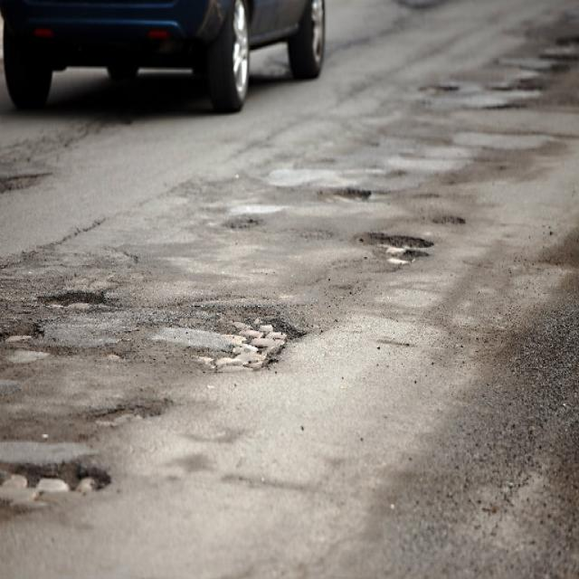
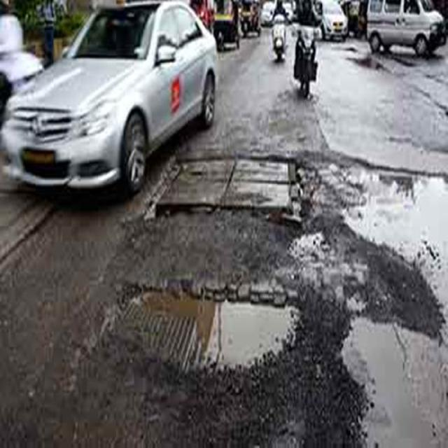
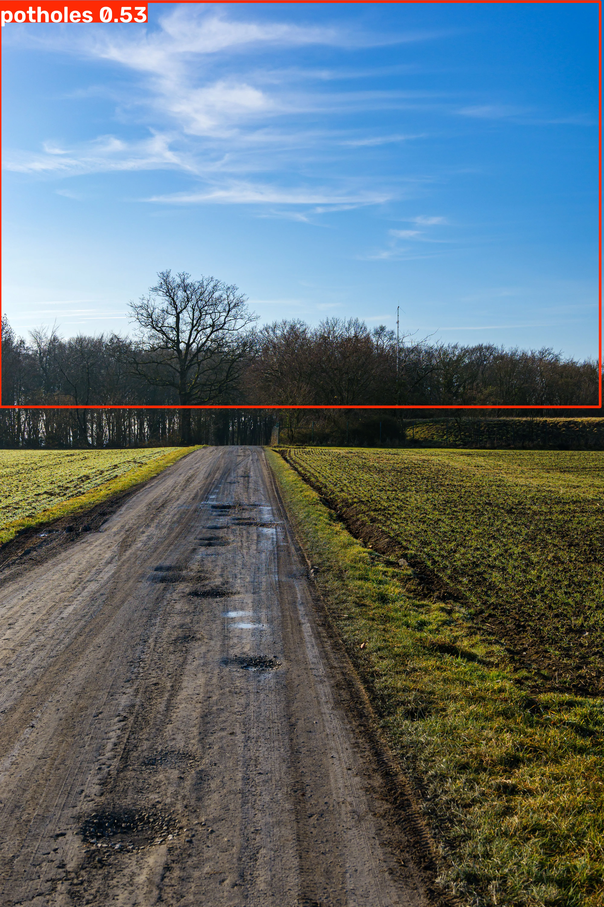
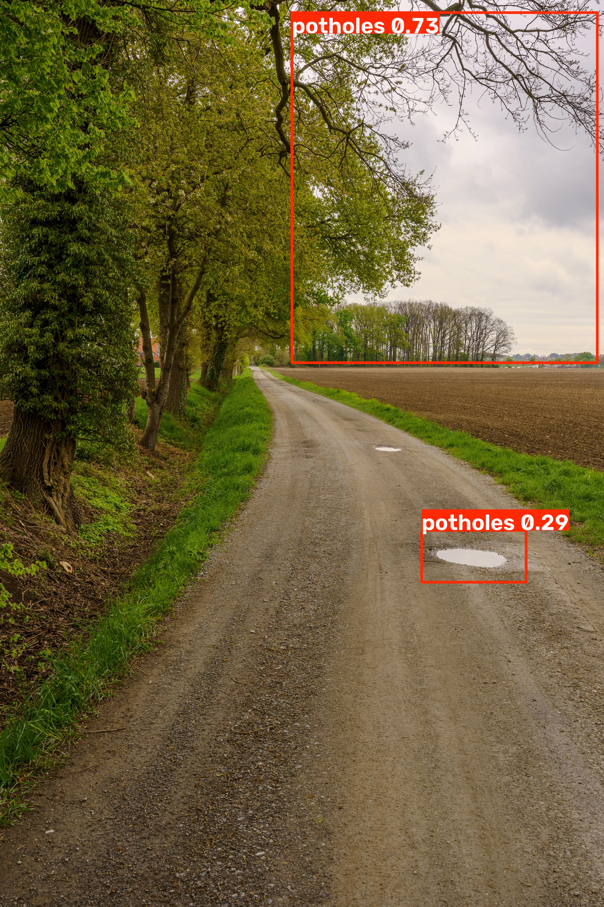
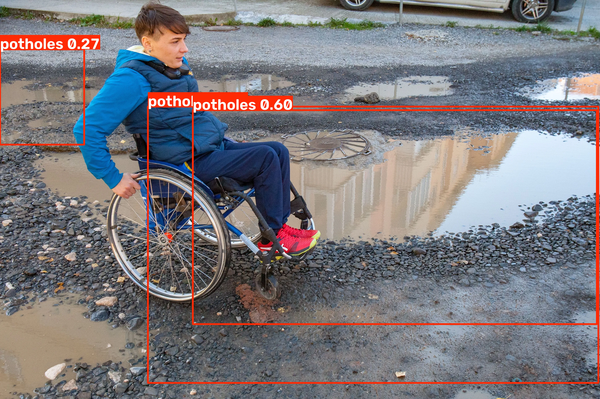

# Pothole & Defect Detector

An AI-powered pothole detection system that takes a road photograph and returns bounding boxes around detected potholes, a confidence score for each detection, and a severity rating based on how much of the image is covered by defects — built for the use case of a municipal road-inspection tool that can scale beyond manual inspection.

## How it works

1. A **YOLOv8n** model, pretrained on COCO, is fine-tuned on a labelled pothole dataset (transfer learning — the backbone's general visual features are kept, only the detection head is retrained for the single `pothole` class).
2. On a new image, the model predicts bounding boxes + confidence scores.
3. **Severity** is computed as `sum of all detected box areas / total image area`, mapped to bands:

| Defect Coverage | Severity |
|---|---|
| No detection | NONE |
| 0–3% | LOW |
| 3–10% | MEDIUM |
| 10–20% | HIGH |
| >20% | CRITICAL |

4. A **Streamlit** web app lets a user upload a photo and see the annotated result, detection details, and severity rating.

## Model metrics

Trained on the `potholedetectionyolov8-5igmy` Roboflow dataset (~550 train / 121 valid images, single class), YOLOv8n, 40 epochs (early-stopped at epoch 27 on patience=10):

| Metric | Score |
|---|---|
| mAP50 | **0.411** |
| mAP50-95 | **0.147** |
| Precision | 0.497 |
| Recall | 0.460 |

**Reading these honestly:** mAP50-95 (0.147) is noticeably lower than mAP50 (0.411) — this gap means the model finds roughly the right *location* for potholes more reliably than it draws a *tightly accurate* box around them. Recall (0.46) means it misses slightly more than half of actual potholes in validation — a real limitation of a small (~550 image), single-class dataset trained on a nano-sized model for a short run, not a tuned, production-grade result.

## Live app

**Note on deployment platform:** the brief calls for Hugging Face Spaces, but during development HF changed its policy so that creating a new Gradio/Docker Space now requires a paid PRO plan (free accounts are limited to 2 ZeroGPU-only Spaces, which wasn't a fit here). Since the brief explicitly allows Gradio **or** Streamlit, this project is deployed on **Streamlit Community Cloud** instead — still a free, live, public deployment that fulfills the same requirement.

🔗 **Live app:** https://tcn-ai-ml-45days-vqwejdg9ktszmkkxcfrgbu.streamlit.app/

## How to run locally

```bash
git clone https://github.com/nbharats/tcn-ai-ml-45days.git
cd tcn-ai-ml-45days/Pothole_Defect_Detector
pip install -r app/requirements.txt
# on Debian/Ubuntu, also: apt-get install -y $(cat app/packages.txt)
streamlit run app/streamlit_app.py
```

To retrain: open `notebooks/train.ipynb` in Colab (GPU runtime recommended), which downloads the dataset from Roboflow, trains YOLOv8n, and reports validation metrics.

## Example detections

| | |
|---|---|
|  |  |
|  | |

## Failure cases — where and why the model fails

**1. Sky misclassified as pothole (confidence 0.53)**

The model boxes a large sky/cloud region as a pothole. Likely cause: training images were consistently close-up, downward-angle road shots; this wide landscape composition with a dominant sky region is out-of-distribution for the training set, and the model appears to have partly keyed on general mottled texture rather than a road-anchored concept of "pothole."

**2. Missed potholes on a visibly damaged road**

Several visible wet/damaged patches along this road go undetected. This is consistent with the model's validation recall of 0.46 — more than half of real potholes are missed, a direct result of the small training set (~550 images) and short training run on a nano-sized model.

**3. Bounding box extends onto a person**

A detection box for a real puddle-pothole sprawls to include part of a person in a wheelchair. This suggests the model is keying on reflective/wet surface texture broadly, rather than tightly bounding the defect itself — a known weakness of a small, single-class dataset with no hard-negative examples of non-road wet surfaces or people.

## Limitations

- Trained on a small (~550 image), single-source dataset — not validated against road conditions, lighting, or camera angles outside what's represented there
- Recall of 0.46 means roughly half of real potholes may go undetected; this tool should supplement, not replace, manual inspection
- The confidence threshold (0.45) was chosen empirically after observing false positives at lower thresholds — not tuned via a formal precision/recall sweep
- Severity scoring is a simple area-ratio heuristic, not validated against real-world repair-priority outcomes
- `.gitignore` excludes the dataset and `runs/` training outputs from GitHub per the brief's requirements; only `app/best.pt` is committed (needed for deployment) and the training notebook is fully reproducible from the public Roboflow dataset

## Repo structure

```
Pothole_Defect_Detector/
├── README.md
├── notebooks/
│   └── train.ipynb          # dataset download, training, metrics
├── app/
│   ├── streamlit_app.py     # deployed web app
│   ├── best.pt               # trained weights
│   ├── requirements.txt
│   └── packages.txt          # system deps (opencv/libGL) for Streamlit Cloud
├── screenshots/
│   ├── example*_working.jpg
│   └── failure_*.jpg
└── .gitignore
```
